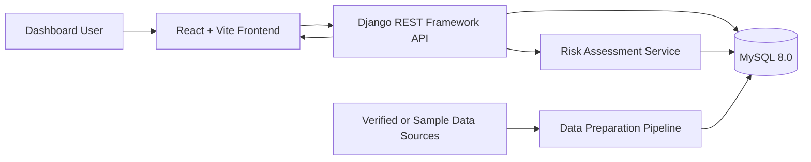

# HeatShield AI — System Architecture

**Status:** Draft for MVP implementation
**Depends on:** `PROJECT_OVERVIEW.md`, `PRD.md`, `SRS.md`, `MVP_SCOPE.md`
**Related:** `TECH_STACK.md`, `DATABASE.md`, `API_SPEC.md`

## 1. Architecture goals

- Deliver a reliable end-to-end area-assessment workflow for the 28 November 2026 demo.
- Keep the risk calculation independent from React presentation code.
- Preserve data provenance and distinguish observed, derived, and illustrative data.
- Make unsupported locations and insufficient data explicit.
- Keep external data providers replaceable; the MVP must not depend on unverified live APIs.

## 2. High-level architecture

## 3. Component responsibilities

### Frontend
- Display supported cities and areas.
- Display the map and area selection controls.
- Request area assessments from the backend.
- Render score, category, indicator contributions, data-quality notes, and recommendations.
- Clearly label sample/illustrative datasets.
- Show loading, empty, insufficient-data, not-found, and server-error states.

### Backend API
- Validate incoming identifiers and query parameters.
- Expose supported locations and assessment results.
- Read persisted area and indicator data.
- Invoke the risk assessment service.
- Return stable response shapes and safe error messages.
- Never convert missing data into a zero-risk result.

### Risk assessment service
- Validate required indicator inputs.
- Apply the versioned scoring method defined in `RISK_SCORING.md`.
- Return score, category, indicator contributions, and data sufficiency information.
- Avoid web calls or UI dependencies.
- Be deterministic for identical inputs and scoring configuration.

### Data preparation pipeline
- Import data from approved files or verified providers.
- Record source, retrieval/observation date, geographic resolution, transformation, and data class.
- Validate ranges, units, geometry/coordinates, and missing values.
- Load validated records into MySQL 8.0.
- Keep raw source files separate from processed outputs.

### MySQL 8.0
- Store configured cities, areas, dataset/source metadata, indicator observations, assessment runs, and recommendation rules.
- Use ordinary latitude/longitude fields for simple point mapping in the first iteration.
- Evaluate MySQL spatial data types and functions only if area geometry storage, spatial joins, or spatial queries are required.

## 4. Main request flow

1. Frontend requests `GET /api/v1/cities/`.
2. User selects a city; frontend requests `GET /api/v1/cities/{city_id}/areas/`.
3. User selects an area; frontend requests `GET /api/v1/areas/{area_id}/assessment/`.
4. Backend checks area existence and available indicator records.
5. Risk service checks data sufficiency and calculates the configured assessment.
6. Backend returns score/category (if calculable), drivers, data quality, recommendations, method version, and data-class flags.
7. Frontend displays the result and its limitations.

## 5. Data flow and provenance

Each imported indicator value must be traceable to:
- source/dataset identifier;
- source record or file where practical;
- observation or reference date;
- import/retrieval date where available;
- geographic resolution;
- unit;
- transformation applied;
- data class: `observed`, `derived`, or `illustrative`.

Do not combine records with incompatible geographic resolutions without a documented aggregation method.

## 6. Deployment shape for MVP

Local demo:
- React dev server.
- Django development server.
- MySQL 8.0 local service.
- Local sample/processed data files.

Production deployment is not required to prove the local working model. Deployment instructions will be defined separately.

## 7. Architecture decisions and open items

| Decision | Current direction | Status |
|---|---|---|
| Frontend/backend separation | React client + Django API | Confirmed direction |
| API style | REST, versioned under `/api/v1/` | Proposed |
| Database | MySQL 8.0 | Confirmed |
| Spatial support | Evaluate MySQL spatial types and functions only if verified polygon or spatial-query requirements exist | Open |
| Authentication | Not required for public read-only demo unless admin writes are exposed | Open |
| External live APIs | Avoid as hard dependency for MVP | Confirmed constraint |
| Background jobs | Not needed for first demo | Deferred |

## 8. Failure handling

- Database unavailable: API returns a server error; UI shows service unavailable.
- Area has no usable data: return an explicit insufficient-data response.
- Invalid area ID: return not found.
- Risk method/configuration invalid: log server-side details and return a safe error.
- External source unavailable: use only previously validated local data or clearly labelled sample data; never fabricate a successful refresh.
