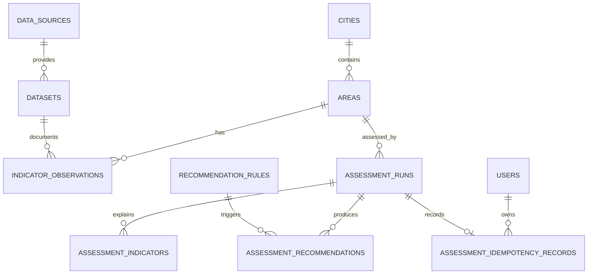

# HeatShield AI — Database Design

**Database:** MySQL 8.0
**Status:** Approved logical MVP schema represented in Django models; assessment migrations 0001 and 0002 are applied to the configured MySQL database.
**Depends on:** `PRD.md`, `SRS.md`, `ARCHITECTURE.md`

## 1. Design principles

- Store location identity separately from indicator observations.
- Preserve source and dataset provenance.
- Distinguish missing values from numeric zero.
- Keep observed, derived, illustrative, mixed, and unavailable assessment provenance distinguishable.
- Store scoring method/version and a configuration snapshot with every new persisted assessment.
- Avoid personal or individually identifiable health data in the MVP.

## 2. Proposed entities

### `cities`
| Field | Type | Rules |
|---|---|---|
| `id` | BIGINT | Primary key |
| `name` | VARCHAR(150) | Required |
| `state_name` | VARCHAR(150) | Required |
| `country_code` | VARCHAR(2) | Required; ISO 3166-1 alpha-2 code, e.g. IN |
| `status` | VARCHAR(20) | Required; allowed values to be approved |
| `created_at` | TIMESTAMP | Required |

### `areas`
| Field | Type | Rules |
|---|---|---|
| `id` | BIGINT | Primary key |
| `city_id` | BIGINT | Required FK to `cities.id` |
| `area_code` | VARCHAR(80) | Nullable; stable code if available |
| `area_name` | VARCHAR(180) | Required within city |
| `area_type` | VARCHAR(50) | Optional; when known, use `city` for a city-wide analysis unit or `ward` only for a verified ward |
| `latitude` | DECIMAL(9,6) | Nullable representative-point latitude |
| `longitude` | DECIMAL(9,6) | Nullable representative-point longitude |
| `geometry` | Deferred approved field | Optional; keep deferred for the MVP because no geometry format or coordinate reference system is approved |
| `created_at` | TIMESTAMP | Required |

### `data_sources`
| Field | Type | Rules |
|---|---|---|
| `id` | BIGINT | Primary key |
| `source_name` | VARCHAR(200) | Required |
| `owner_name` | VARCHAR(200) | Required |
| `official_url` | TEXT | Nullable |
| `licence_terms` | TEXT | Nullable; usage conditions must be checked |
| `approval_status` | VARCHAR(30) | Required; allowed values to be approved |
| `created_at` | TIMESTAMP | Required |

### `datasets`
| Field | Type | Rules |
|---|---|---|
| `id` | BIGINT | Primary key |
| `source_id` | BIGINT | Required FK to `data_sources.id` |
| `dataset_name` | VARCHAR(200) | Required |
| `data_class` | VARCHAR(20) | Required; observed, derived, illustrative |
| `spatial_resolution` | VARCHAR(100) | Required |
| `published_at` | DATE | Nullable |
| `coverage_start` | DATE | Nullable |
| `coverage_end` | DATE | Nullable |
| `retrieved_at` | TIMESTAMP | Required for imported datasets |
| `file_hash` | VARCHAR(128) | Nullable until file-based ingestion is used |
| `transformation_notes` | TEXT | Nullable |
| `is_active` | BOOLEAN | Required; default false until validation |

### `indicator_observations`
| Field | Type | Rules |
|---|---|---|
| `id` | BIGINT | Primary key |
| `area_id` | BIGINT | Required FK to `areas.id` |
| `dataset_id` | BIGINT | Required FK to `datasets.id` |
| `indicator_code` | VARCHAR(100) | Required stable indicator code |
| `period_start` | DATE | Required observation period start |
| `period_end` | DATE | Required observation period end; same as start for single-day observations |
| `raw_value_numeric` | DECIMAL(16,6) | Nullable; original numeric value |
| `raw_value_text` | TEXT | Nullable; original categorical or text value |
| `raw_unit` | VARCHAR(60) | Nullable; original source unit |
| `quality_status` | VARCHAR(30) | Required; allowed values to be approved |
| `notes` | TEXT | Nullable |

### `assessment_runs`
| Field | Type | Rules |
|---|---|---|
| `id` | BIGINT | Primary key |
| `area_id` | BIGINT | Required FK to `areas.id`; one run assesses one area |
| `method_version` | VARCHAR(40) | Required |
| `configuration_version` | VARCHAR(40) | Required for reproducibility |
| `configuration_snapshot` | JSON | Nullable for assessments created before snapshot support; new runs store the exact scoring settings |
| `score` | DECIMAL(6,2) | Nullable if insufficient data |
| `risk_category` | VARCHAR(30) | Nullable until thresholds are approved |
| `data_coverage` | DECIMAL(5,2) | Nullable until defined |
| `data_class` | VARCHAR(20) | Required; observed, derived, illustrative, mixed, unavailable |
| `status` | VARCHAR(30) | e.g. SCORED, INSUFFICIENT_DATA, NOT_READY, REVIEW_REQUIRED |
| `run_at` | TIMESTAMP | Required; store with explicit timezone handling |

### `assessment_indicators`
| Field | Type | Rules |
|---|---|---|
| `id` | BIGINT | Primary key |
| `assessment_run_id` | BIGINT | Required FK to `assessment_runs.id` |
| `indicator_code` | VARCHAR(100) | Required |
| `input_value_numeric` | DECIMAL(16,6) | Nullable; original numeric input |
| `input_value_text` | TEXT | Nullable; original categorical or text input |
| `normalized_value` | DECIMAL(8,4) | Nullable |
| `weight_used` | DECIMAL(8,4) | Nullable; exact configuration weight |
| `contribution` | DECIMAL(8,4) | Nullable |
| `quality_status` | VARCHAR(30) | Required; use approved quality status values |
| `explanation` | TEXT | Required when indicator is used |

### `recommendation_rules`
| Field | Type | Rules |
|---|---|---|
| `id` | BIGINT | Primary key |
| `rule_code` | VARCHAR(100) | Required; stable rule identifier |
| `title` | VARCHAR(180) | Required |
| `condition_config` | JSON | Required; conditions for triggering the rule |
| `recommendation_text` | TEXT | Required |
| `priority` | VARCHAR(20) | Required; low, medium, high |
| `version` | VARCHAR(40) | Required; rule version |
| `is_active` | BOOLEAN | Required; default false until validated |

### `assessment_recommendations`
| Field | Type | Rules |
|---|---|---|
| `id` | BIGINT | Primary key |
| `assessment_run_id` | BIGINT | Required FK to `assessment_runs.id` |
| `recommendation_rule_id` | BIGINT | Required FK to `recommendation_rules.id` |
| `rule_version_applied` | VARCHAR(40) | Required; version used when the recommendation was triggered |
| `rule_snapshot` | JSON | Nullable for historical records; new records snapshot rule code, title, text, priority, and version |
| `trigger_explanation` | TEXT | Nullable; explanation of why the rule matched |
| `created_at` | TIMESTAMP | Required |

### `assessment_idempotency_records`
| Field | Type | Rules |
|---|---|---|
| `id` | BIGINT | Primary key |
| `user_id` | BIGINT | Required FK to the configured Django user model; cascade on user deletion |
| `key` | VARCHAR(128) | Required; URL-safe characters; normalized case-insensitively |
| `request_fingerprint` | VARCHAR(64) | Required; SHA-256 of the canonical validated request payload |
| `assessment_run_id` | BIGINT | Required one-to-one FK to `assessment_runs.id`; cascade on run deletion |

## 3. Relationships

The `assessment_recommendations` table records which rules were triggered by an assessment and snapshots the applied rule content for new records. Existing records have no recoverable content snapshot and are not backfilled from mutable rules.

## 4. Constraints and indexes

- Unique city identity using `(name, state_name, country_code)`; confirm case and collation behaviour.
- Unique area name using `(city_id, area_name)`.
- Unique non-null area code using `(city_id, area_code)`; multiple NULL area codes are allowed.
- Index `areas.city_id`.
- Index `indicator_observations(area_id, indicator_code)`.
- Index `assessment_runs(area_id, run_at)`.
- Unique `(user_id, key)` on `assessment_idempotency_records`; keys are scoped to a user.
- Unique `assessment_run_id` on `assessment_idempotency_records` through its one-to-one relationship.
- Foreign keys must prevent orphaned observations and assessments.
- Validate latitude range [-90, 90] and longitude range [-180, 180].
- Use database transactions for multi-record imports.
- Create an assessment run and its idempotency record in one transaction. Replays with the same user/key and fingerprint return the existing run; a different fingerprint returns a conflict.

New assessment runs persist the exact scoring configuration in `configuration_snapshot`. Existing runs retain a nullable snapshot rather than receiving a potentially inaccurate backfill. `unavailable` is stored when no eligible input was used.

## 5. MySQL spatial decision

Start with representative latitude/longitude coordinates if they satisfy MVP requirements. Evaluate MySQL spatial data types and functions if actual polygons, spatial joins, point-in-polygon operations, or spatial filtering are required. Define and validate the coordinate reference system and imported geometries before using them.

The MVP does not implement a geometry storage field or MySQL spatial type. The approved logical `geometry` field remains in the schema specification but is deferred until an approved representation and coordinate reference system are available. The field must not be represented as ordinary text or as a spatial type until that approval is complete.

### MVP area representation

- Use `area_type="city"` for the single city-wide analysis unit.
- Use `area_type="ward"` only for a verified ward with approved boundaries and ward-level source data.
- For Meerut, create no ward records unless verified ward boundaries and ward-level observations are available.
- City-level observations must use a city-type area and must never be attached to a ward-type area.
- `Dataset.spatial_resolution` must identify city-level provenance rather than implying ward-level coverage.

The repeatable demo setup command
`python manage.py setup_demo_city` creates only a Meerut city and the
`Meerut City` city-level area when absent. It preserves existing records and creates
no coordinates, ward areas, observations, datasets, assessment runs, or recommendations.
The separate repeatable command `python manage.py setup_recommendation_rules`
creates missing active recommendation rules only. It preserves existing rules and
does not create assessment runs or applied recommendation records; recommendations
are attached to newly created assessments when an active rule matches.

## 6. Open decisions

- Whether area boundaries are available and licensed.
- Whether MySQL spatial features are required for the selected demo dataset.
- Assessments are persisted as `assessment_runs`, with indicator breakdowns and triggered recommendations, to support history and reproducibility. Each request creates a new run; prior runs are retained.
- Exact indicator catalogue and units.
- Final nullability and field types after sample data review.
